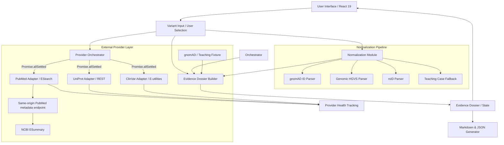

# VariantVision Pro — System Architecture

VariantVision Pro is an evidence-first bioinformatics workbench engineered to aggregate, normalize, interpret, and present genomic variant evidence from multiple authoritative scientific sources.

This document describes the software architecture, data flow, provider abstraction, normalization pipeline, and error handling model.

---

## 1. Architectural Principles

1. **Provenance First**: Retrieved records retain attribution, URLs, status, timestamps and warnings. Illustrative population fixtures remain explicitly identified as fixtures.
2. **Graceful Partial Failure**: External scientific APIs fail independently (timeouts, CORS restrictions, maintenance, missing endpoints). If one provider fails, the workbench continues operating with remaining providers.
3. **Explicit Boundaries**: The application enforces clear visual and textual boundaries separating educational research triage from clinical diagnosis or ACMG/AMP classification.
4. **Local Domain Calculations**: Coordinate parsing, amino acid properties and coverage calculations run locally. Dossiers separately stamp generation time and attach retrieval provenance.

---

## 2. Component Diagram & Data Flow



---

## 3. Provider Abstraction Layer

All external data sources implement the `ProviderResult<T>` interface:

```typescript
export interface ProviderResult<T> {
  provider: ProviderName
  status: 'success' | 'no_result' | 'error' | 'timeout' | 'unavailable' | 'unsupported_variant'
  data: T | null
  error: string | null
  retrievedAt: string // ISO 8601
  variantIdUsed: string
  sourceUrl: string | null
  warnings: string[]
  durationMs: number
}
```

### Key Components

- **ClinVar Adapter (`src/providers/clinvar.ts`)**: Searches by rsID, then validates a single SNV against assembly locations and canonical SPDI. Compound records and alternate alleles are excluded; zero or multiple exact matches produce no selected assertion. Germline, clinical impact and oncogenicity tracks remain separate.
- **UniProt Adapter (`src/providers/uniprot.ts`)**: Queries UniProt REST API (`rest.uniprot.org`) by accession ID to retrieve functional annotations, subcellular location, and review status (Swiss-Prot vs TrEMBL).
- **PubMed Adapter (`src/providers/pubmed.ts`)**: Searches NCBI by gene/variant terms. Summaries use `api/pubmed.ts` and `server/pubmedSummary.ts`, a fixed-upstream Node handler shared with Vite. Only one to five unique numeric PMIDs are accepted; arbitrary upstream URLs and non-GET methods are rejected.
- **Orchestrator (`src/providers/orchestrator.ts`)**: Executes all active providers concurrently via `Promise.allSettled` with configurable timeouts (default 8000ms). Returns unified `OrchestratorResult` containing data and provider health metrics.
- **Scheduling and State**: NCBI request slots are reserved synchronously before waiting. Editing identity, changing case/build or resetting invalidates the request generation; late results cannot replace the current dossier.

---

## 4. Variant Normalization Pipeline

Variant inputs are routed through four sequential normalization strategies in `src/modules/variant/normalizeVariant.ts`:

1. **gnomAD-style ID**: Accepts primary chromosome labels, positive safe integer positions and concrete differing DNA alleles. Produces a dataset URL and 1-based coordinate string; this is syntactic routing, not reference validation or left alignment.
2. **Genomic HGVS**: Matches `g.(\d+)([ACGT])>([ACGT])` with RefSeq chromosome inference (`NC_000011` → Chr 11).
3. **rsID Lookup**: Matches `^rs\d+$`. Routes to NCBI dbSNP URL for coordinate resolution.
4. **Teaching Case Fallback**: Matches canonical educational examples (e.g. HBB E6V / HbS) to GRCh37 or GRCh38 coordinates.

If all local normalization paths fail, the system assigns status `manual review required` rather than generating unsafe coordinate assumptions.
Conflicting HGVS/gnomAD alleles and known RefSeq assembly mismatches also withhold routing. Teaching cases have verified coordinates in both builds; custom build changes clear coordinates instead of attempting liftover.

---

## 5. Evidence Coverage & Scoring Model

The `buildDossier` engine computes an uncalibrated workflow coverage heuristic by averaging five component scores equally:

1. **Normalization (20%)**: Evaluates whether the variant maps to a coordinate-level identifier.
2. **Population Frequency (20%)**: Evaluates availability of population allele frequency data.
3. **Curated Database Review (20%)**: Evaluates ClinVar classifications and review status stars.
4. **Protein / Structure Context (20%)**: Evaluates UniProt functional annotation and domain mapping.
5. **Literature Handoff (20%)**: Evaluates availability of primary PubMed citations.

Source-status scores are ready=100, partial=70, review=55 and missing=10; source dimensions average their records. Coordinate routing scores 94 when available and 25 otherwise. Literature lead counts score 88 for two or more, 68 for one and 20 for none. These fixed rules measure workflow availability and do not validate evidence quality or clinical confidence.

Coverage bands match the UI: 82–100 high source coverage, 60–81 moderate source coverage, below 60 limited source coverage. Population cohorts are never pooled; missing observations remain distinct from a zero frequency.

---

## 6. Security and Privacy Policy

- **No API Keys Required**: Public endpoints (NCBI E-utilities, UniProt REST) are used without private keys, avoiding client-side credential exposure.
- **Data Flow**: Live retrieval sends gene/variant queries to NCBI and protein IDs to UniProt. Public PubMed IDs pass through the metadata endpoint. Application code does not persist inputs or responses; hosting infrastructure can retain normal request metadata.
- **Strict Content Sanitization**: All external text fields are treated as plain text strings rendered safely via React.
